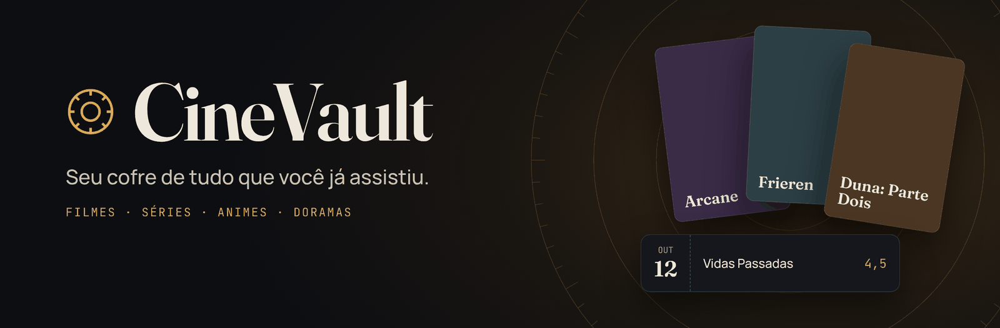
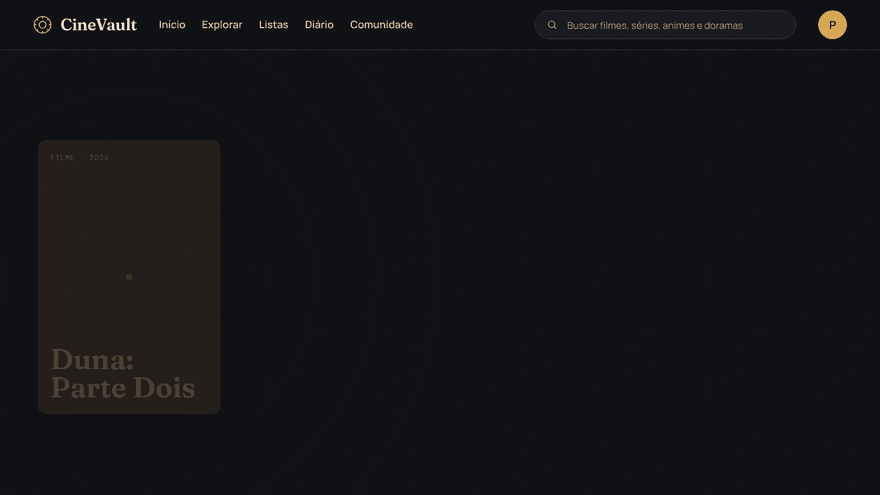
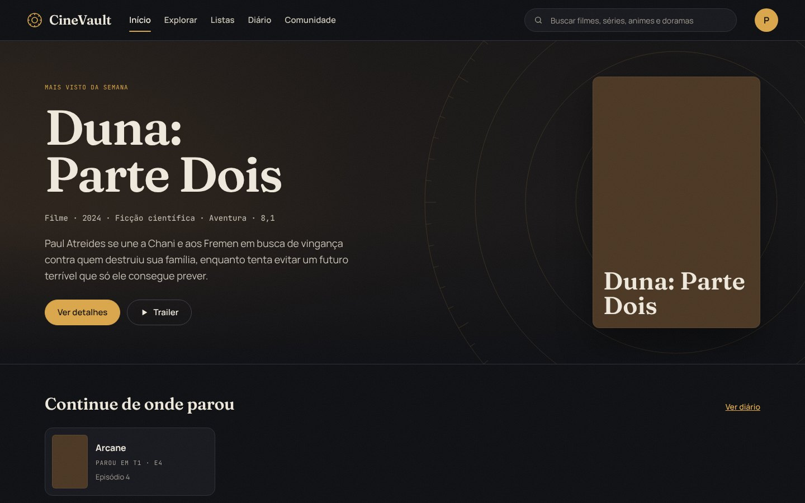
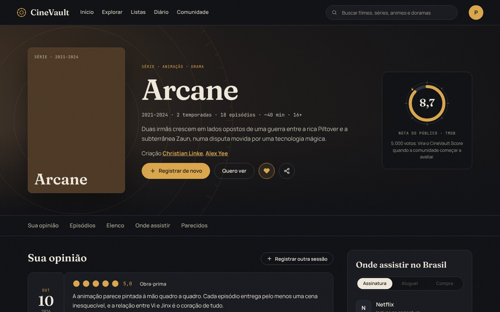
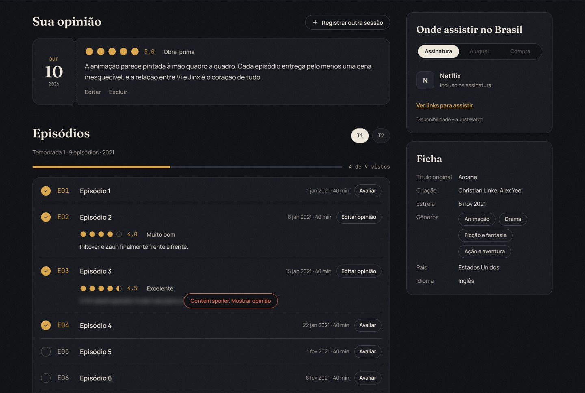
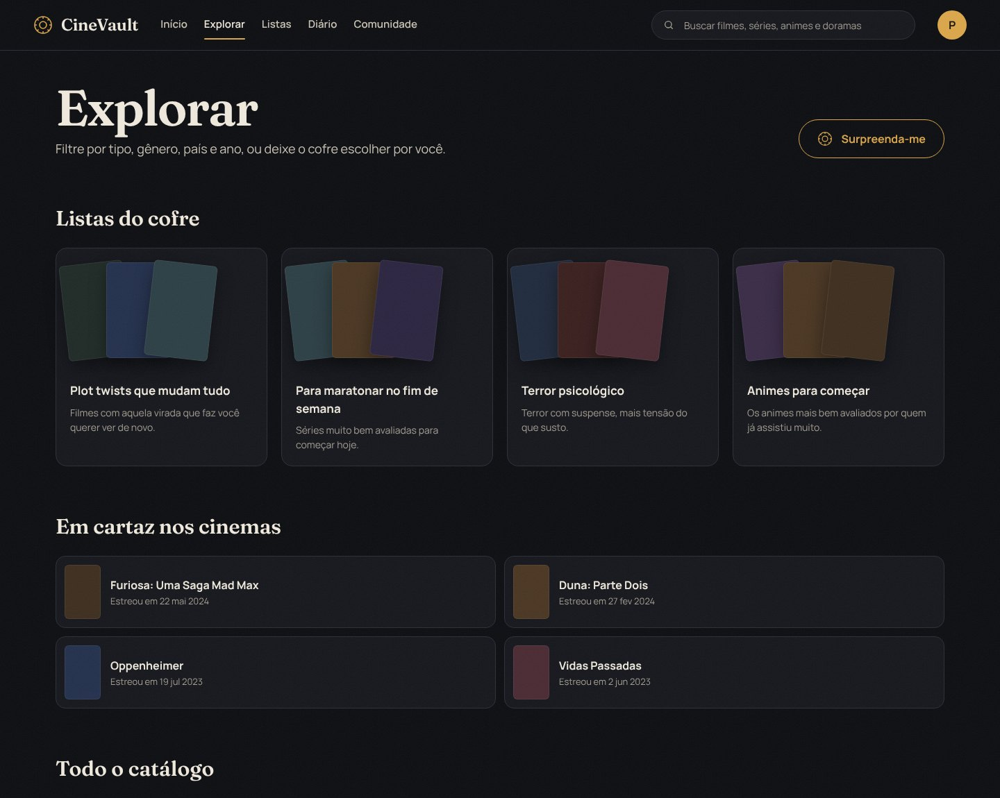
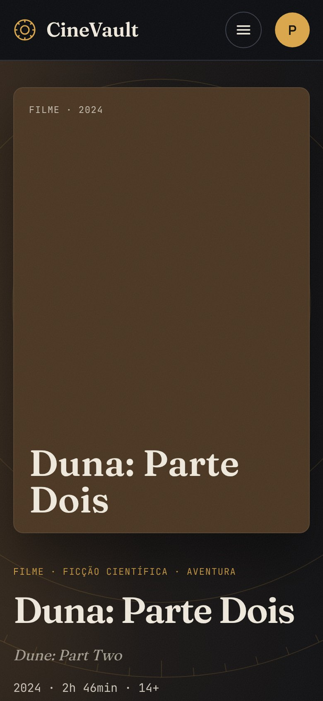
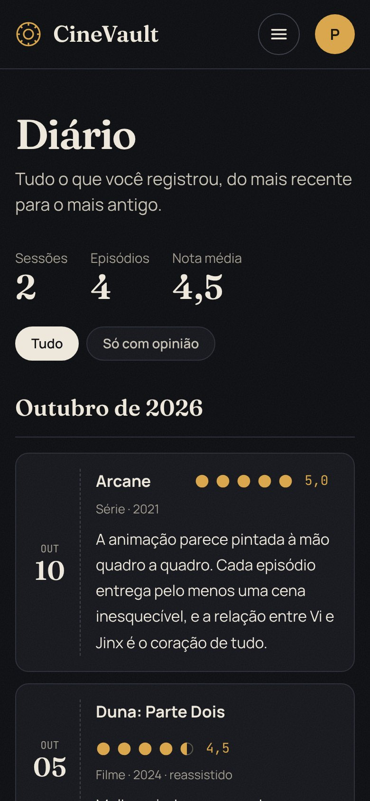
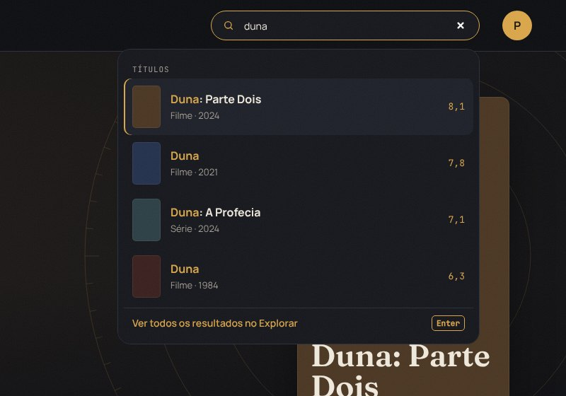
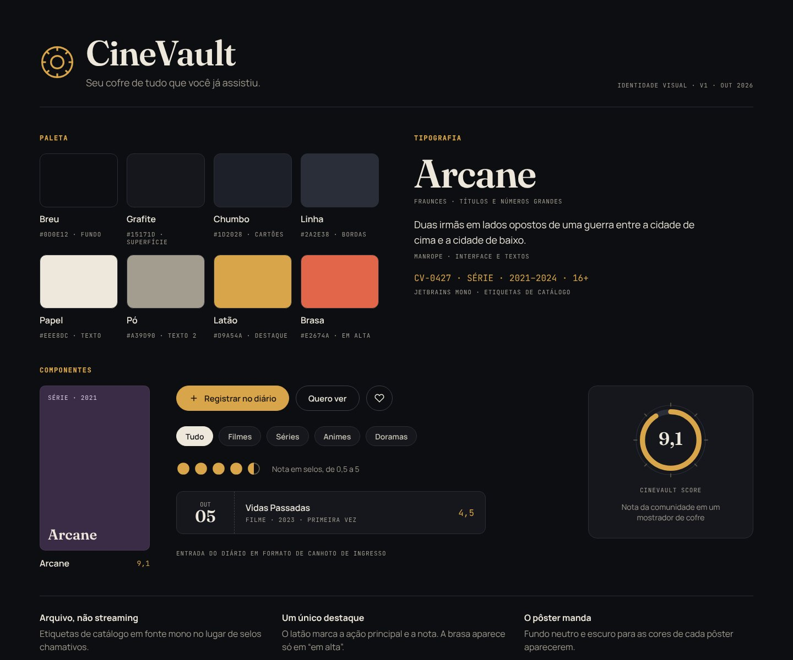

<p align="center">
  
</p>

<p align="center">
  <b>Um diário pessoal de filmes, séries, animes e doramas.</b><br>
  Registre o que assistiu, dê sua nota, escreva o que achou e descubra o que ver a seguir, sem pular de app em app.
</p>

<p align="center">
  
  
  
  <br>
  
  
  
  
  
  <br>
  
  
</p>

<p align="center">
  <a href="#funcionalidades">Funcionalidades</a> ·
  <a href="#telas">Telas</a> ·
  <a href="#identidade">Identidade</a> ·
  <a href="#como-rodar">Como rodar</a> ·
  <a href="#roadmap">Roadmap</a> ·
  <a href="#equipe">Equipe</a>
</p>

---

## 🔐 A abertura do cofre

<p align="center">
  
</p>

Cada título abre como um cofre: o fundo se revela em íris a partir do pôster, um aro de latão se expande e o mostrador gira em cliques até a nota, como a combinação de um cofre. É a assinatura do CineVault: um único momento marcante, em vez de efeitos espalhados por todo canto.

<a id="funcionalidades"></a>

## ✨ O que dá para fazer

| Recurso | Como funciona |
| --- | --- |
| 📓 **Diário** | Registre cada vez que assistiu, com data, nota de 0,5 a 5 e se foi uma reassistida. Tudo organizado por mês. |
| ✍️ **Opiniões** | Escreva o que achou de um filme, de uma série ou de **cada episódio**. Marque como spoiler e o texto fica borrado até alguém pedir para ver. |
| 📺 **Episódios** | Marque o que já viu, acompanhe o progresso da temporada e volte de onde parou pelo Início. |
| 🧭 **Explorar** | Filtre por tipo, gênero, país, década, streaming e nota mínima. Os filtros ficam na URL, então dá para salvar e compartilhar. |
| 🎲 **Surpreenda-me** | Sorteia um título bem avaliado quando você não sabe o que ver. |
| 🗂️ **Listas do cofre** | Atalhos prontos, como plot twists, terror psicológico, animes para começar e séries para maratonar. |
| 🔎 **Busca** | Sugestões enquanto você digita, com títulos e pessoas, totalmente navegável pelo teclado. |
| 🎭 **Pessoas** | Biografia, "conhecido por" e filmografia de atores e diretores, filtrável por função. |
| 📍 **Onde assistir** | Em quais streamings o título está disponível no Brasil, por assinatura, aluguel ou compra. |
| ⭐ **Quero ver e favoritos** | Guarde o que quer assistir e o que mais marcou você. |
| 💬 **Curador** | Um chat no canto da tela: peça indicações, conte o que viu e receba títulos parecidos, com link e botão de "Quero ver". |
| ☁️ **Conta e nuvem** | Entre com o Google (ou e-mail) e seu diário aparece em qualquer aparelho. Sem conta, tudo fica salvo no navegador. |

O CineVault separa o catálogo em **filmes**, **séries**, **animes** (séries animadas japonesas) e **doramas** (séries asiáticas com atores), em vez de juntar tudo como "programa de TV".

<a id="telas"></a>

## 🖼️ Telas

<table>
  <tr>
    <td width="50%"><br><sub><b>Início</b>: os destaques da semana girando como um cofre, o que está em alta e o seu diário.</sub></td>
    <td width="50%"><br><sub><b>Título</b>: nota do público, onde assistir, elenco e temporadas.</sub></td>
  </tr>
  <tr>
    <td><br><sub><b>Sua opinião</b>: a sessão no diário e a nota de cada episódio, com spoiler protegido.</sub></td>
    <td><br><sub><b>Explorar</b>: listas do cofre, estreias e o catálogo com filtros.</sub></td>
  </tr>
</table>

<table>
  <tr>
    <td width="33%"></td>
    <td width="33%"></td>
    <td width="34%"><br><sub><b>Busca</b>: sugestões enquanto digita, com o trecho buscado em destaque.</sub><br><br><sub>Funciona do celular ao desktop, com foco visível no teclado e respeito ao "reduzir movimento" do sistema.</sub></td>
  </tr>
</table>

<sub>Capturas no modo demonstração, que roda sem token e mostra os pôsteres como blocos de cor. Com o token do TMDB, aparecem os pôsteres, fotos e fundos reais.</sub>

<a id="identidade"></a>

## 🎨 Identidade visual

**Cofre, não streaming.** O CineVault não quer parecer mais uma vitrine vermelha de streaming. Ele é um acervo pessoal e catalogado: fundos escuros que deixam os pôsteres brilharem, latão como único destaque e etiquetas de catálogo como as de um arquivo.

<p align="center">
  
</p>

| Papel | Nome | Hex |
| --- | --- | --- |
| Fundo | Breu | `#0D0E12` |
| Superfícies | Grafite e Chumbo | `#15171D` · `#1D2028` |
| Texto | Papel | `#EEE8DC` |
| Destaque | Latão | `#D9A54A` |
| Em alta e spoilers | Brasa | `#E2674A` |

- **Fraunces** para títulos e números grandes, **Manrope** para a interface e **JetBrains Mono** para as etiquetas de catálogo.
- O diário usa **canhotos de ingresso**, as notas são **selos** e a nota do público aparece num **mostrador de cofre**.
- O carregamento é a roda do cofre girando a combinação, para um lado e para o outro.

## 🧱 Tecnologias

**Frontend** (`web/`)

- **[Next.js 16](https://nextjs.org)** com App Router, **React 19** e **TypeScript**
- **CSS Modules** e design tokens próprios, sem framework de CSS. Cada componente tem seu estilo isolado.
- **[API do TMDB](https://developer.themoviedb.org)** para o catálogo, chamada só no servidor e com cache
- **Curador**, o chat de indicações, com qualquer IA no formato da OpenAI (Gemini, Groq, Ollama ou Claude) e um modo simples que funciona sem IA
- **Fontsource** para servir as fontes pelo próprio site
- Toda a lógica do catálogo fica em `web/src/services/catalog` e a dos dados do usuário em `web/src/services/user`. As páginas nunca chamam a API diretamente.

**Backend** (`CineVault.API/`)

- **[ASP.NET Core](https://dotnet.microsoft.com/apps/aspnet)** com **.NET 10** e **C#**
- **Entity Framework Core** com **SQL Server**
- Login com **JWT** e senhas com **BCrypt**
- **Swagger** para testar as rotas no navegador

<a id="como-rodar"></a>

## 🚀 Como rodar

### Frontend

Você precisa do **Node.js 20.9** ou mais novo.

```bash
git clone https://github.com/pedrobaschoni/CineVault.git
cd CineVault/web
npm install
cp .env.example .env.local
npm run dev
```

Abra **http://localhost:3000**.

**Token do TMDB.** Crie uma conta gratuita no [TMDB](https://www.themoviedb.org), vá em **Configurações › API** e copie o **token de leitura da API** para o `.env.local`:

```env
TMDB_API_TOKEN=eyJ...
```

> Sem token, o site roda em **modo demonstração**, com cerca de 40 títulos de exemplo. Dá para testar tudo antes mesmo de criar a conta.

**Login com o Google (opcional).** Sem configurar nada, o site funciona sem login e salva o diário no navegador. Para ativar o login e a nuvem, crie um projeto gratuito no Supabase e siga o [passo a passo do README do frontend](web/README.md#login-com-o-google-e-dados-na-nuvem-supabase-opcional).

**Curador com IA (opcional).** Sem configurar nada, o chat responde no modo simples. Para conversar de verdade, siga o [passo a passo do README do frontend](web/README.md#curador-o-chat-de-indicações-opcional).

Os detalhes técnicos (rotas, estrutura de pastas e convenções) estão no [README do frontend](web/README.md).

### API

Você precisa do **[.NET 10 SDK](https://dotnet.microsoft.com/download)** e de um **SQL Server** (o Express ou o LocalDB servem).

```bash
cd CineVault.API
dotnet user-secrets init
dotnet user-secrets set "ConnectionStrings:CineVaultConnection" "Server=localhost;Database=cinevault;Trusted_Connection=True;TrustServerCertificate=True;"
dotnet user-secrets set "Jwt:Key" "uma-chave-longa-e-aleatoria"
dotnet user-secrets set "TMDB:ApiKey" "sua-chave-do-tmdb"
dotnet run
```

A API sobe em **http://localhost:5008**, e o Swagger fica em **http://localhost:5008/swagger**. As chaves ficam no `user-secrets`, fora do repositório: nunca as coloque no `appsettings.json`.

## 📁 Estrutura do repositório

```
CineVault/
├── web/             frontend (Next.js)
├── CineVault.API/   backend (ASP.NET Core)
├── backend/         Dockerfile da API
├── frontend-2/      versão antiga do frontend, mantida só como referência
└── docs/            imagens deste README
```

<a id="roadmap"></a>

## 🛣️ Roadmap

- [x] **Fase 1: fundação e identidade.** Design tokens, componentes, navegação, landing e "Sobre".
- [x] **Fase 2: catálogo real.** TMDB, páginas de título e de pessoa, Explorar, busca e a abertura do cofre.
- [ ] **Fase 3: dados do usuário.** Diário, opiniões, episódios, listas e o Curador já funcionam no navegador. A API já tem cadastro, login, avaliações e favoritos. Faltam ligar o frontend na API e as páginas de listas e perfil.
- [ ] **Fase 4: experiência.** Estatísticas pessoais e a comunidade, com reviews públicas e ranking de usuários.
- [ ] **Fase 5: diferenciais.**
  - Cofre do ano, uma retrospectiva anual.
  - Compatibilidade de gosto entre amigos.
  - Importação do Letterboxd e do MyAnimeList.

<a id="equipe"></a>

## 👥 Equipe

| | Quem | Parte |
| --- | --- | --- |
| 🎨 | **[Pedro Baschoni](https://github.com/pedrobaschoni)** | Frontend, identidade visual e o Curador |
| ⚙️ | **[Adryan Luis dos Santos](https://github.com/AdryanLuis)** | Backend: API, banco de dados e autenticação |

## 🙏 Créditos

<a href="https://www.themoviedb.org"></a>

Os dados de filmes, séries e pessoas vêm do [TMDB](https://www.themoviedb.org). **Este produto usa a API do TMDB, mas não é endossado nem certificado pelo TMDB.** Os dados de onde assistir vêm do [JustWatch](https://www.justwatch.com), por meio do TMDB.

---

<p align="center">
  Feito por <a href="https://github.com/pedrobaschoni">Pedro Baschoni</a> e <a href="https://github.com/AdryanLuis">Adryan Luis dos Santos</a>.<br>
  <sub>Se o CineVault te deu uma ideia, deixe uma ⭐ no repositório.</sub>
</p>
